# Quolia

**Read. Highlight. Remember.**

Quolia is a quiet, native reading app for iPhone and iPad. Import your own EPUB, FB2, PDF and TXT books, read them in a calm reader, keep highlights and notes, and let Quolia bring important ideas back to you over time.

Built with Swift, SwiftUI, SwiftData + CloudKit, TextKit, PDFKit, Vision, NaturalLanguage, AVFoundation, Translation and Foundation Models. There are no third-party dependencies.

## Screenshots

| Library | Reader | Select text | Highlight |
|:---:|:---:|:---:|:---:|
| 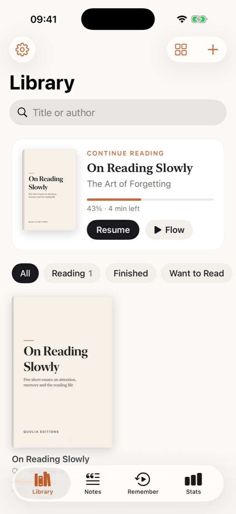 | 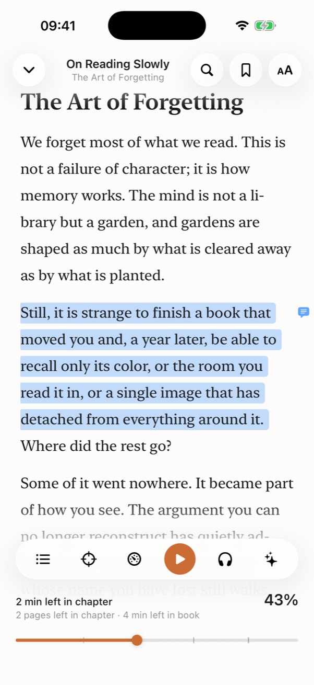 | 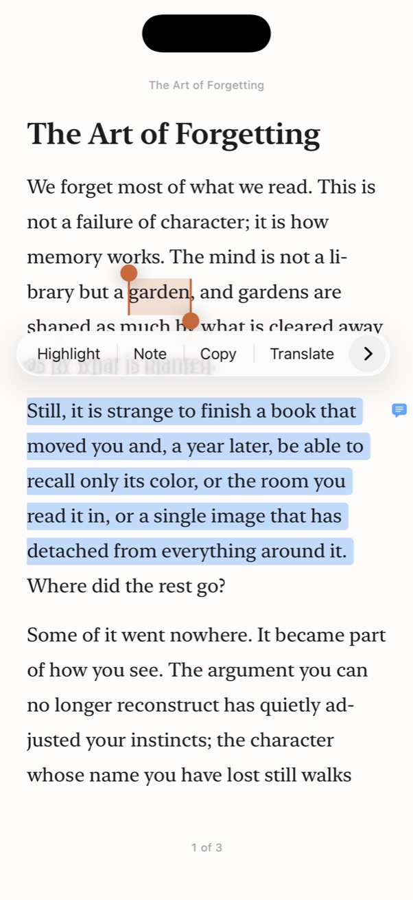 | 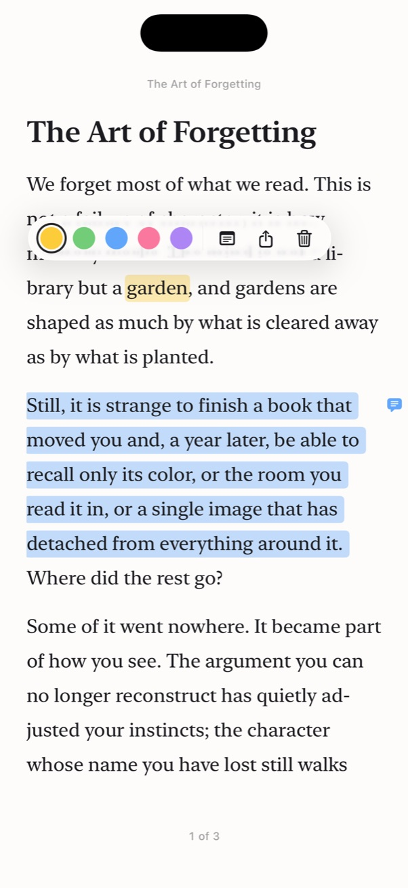 |

| Focus Mode | Quotes & Notes | Remember | Stats |
|:---:|:---:|:---:|:---:|
| 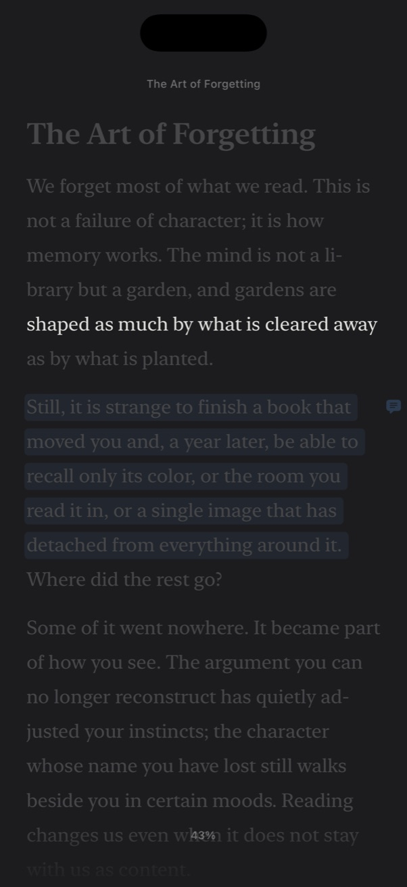 | 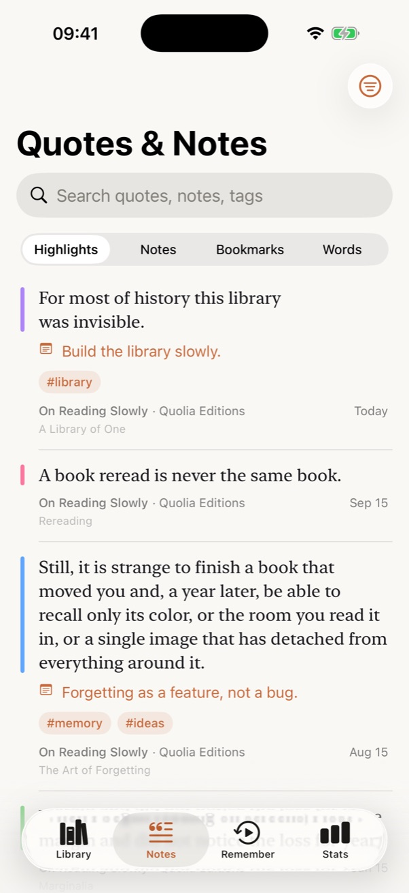 | 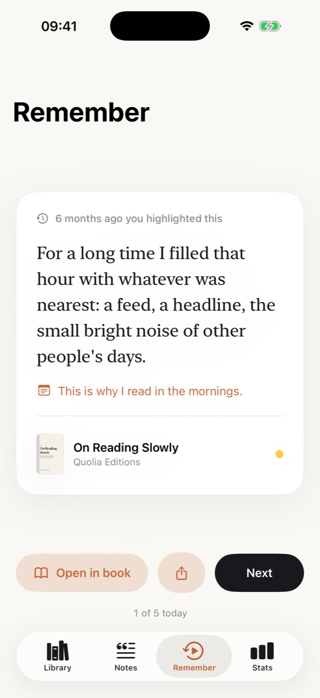 | 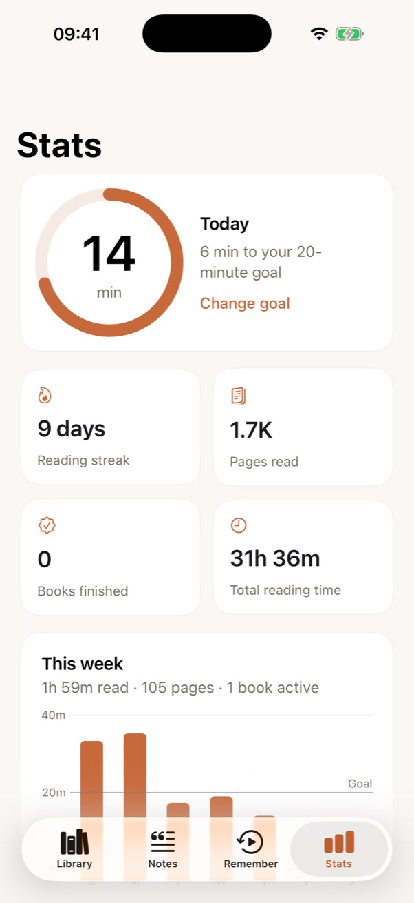 |

| Onboarding | Quote Cards | Reading Flow | In Russian |
|:---:|:---:|:---:|:---:|
| 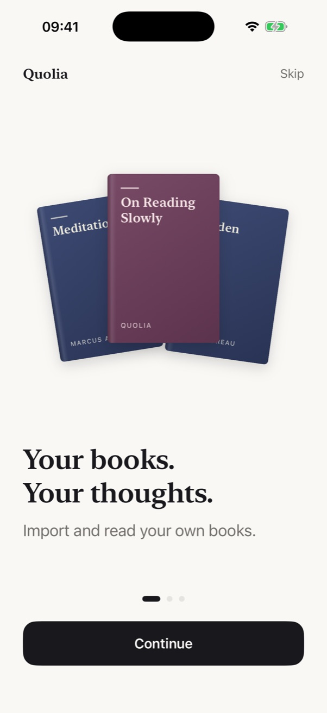 | 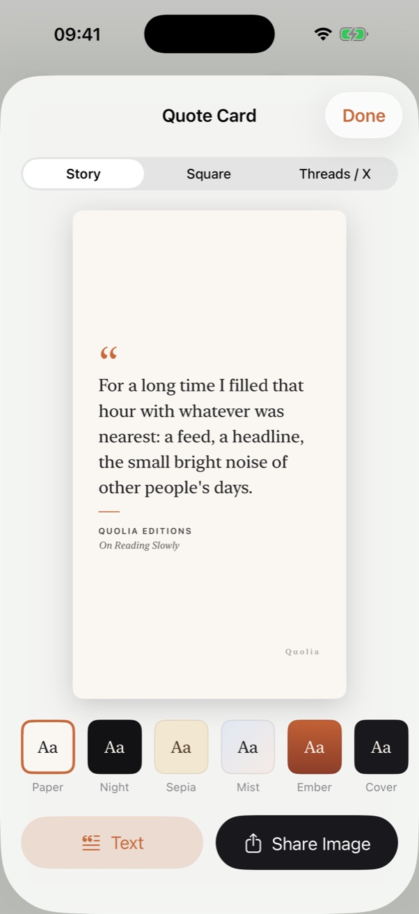 | 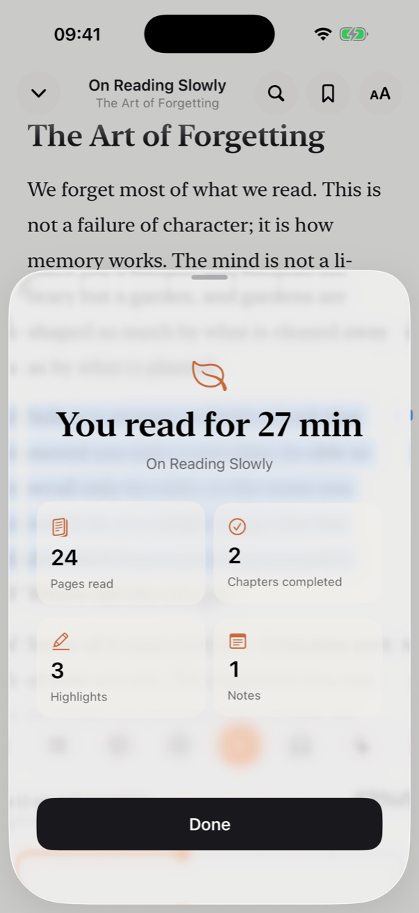 | 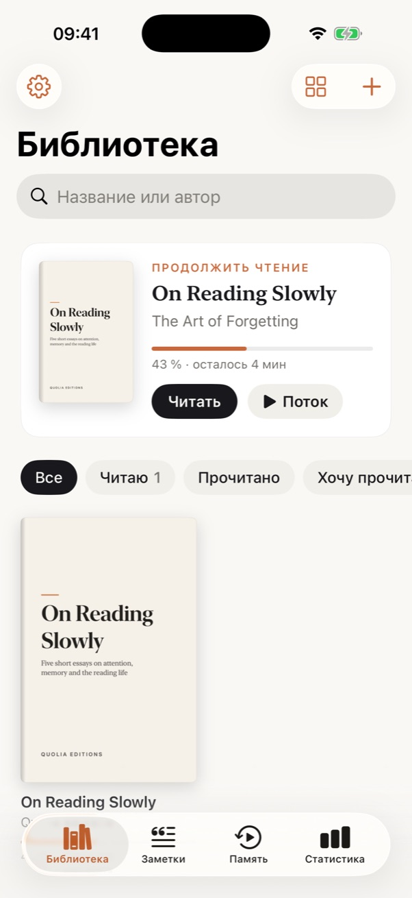 |

Original-layout PDFs follow the reader theme (light, dark, black, sepia), and highlights keep their colors:

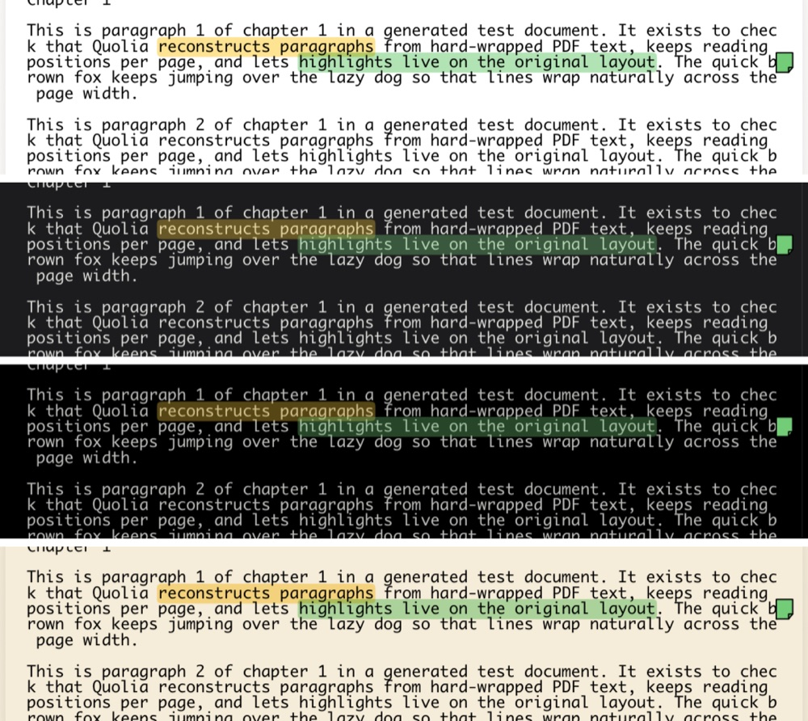

## Getting started

Requirements: Xcode 26+, iOS 18+ deployment target. On-device AI needs iOS 26 and Apple Intelligence.

```bash
brew install xcodegen   # project.yml is the source of truth for Quolia.xcodeproj
xcodegen generate
open Quolia.xcodeproj
```

To run on a device or turn on sync:

1. Choose your **Team** under *Signing & Capabilities*.
2. Change the identifiers to your own:
   - bundle IDs `com.quolia.reader` and `com.quolia.reader.share` (`project.yml`);
   - the iCloud container `iCloud.com.quolia.reader` (`project.yml`, `BookFileStore.containerIdentifier`);
   - the App Group `group.com.quolia.reader` (`project.yml`, `SharedInbox.appGroup`).
3. The entitlements already list CloudKit, iCloud Documents, iCloud key-value storage, push (for CloudKit change notifications) and the App Group shared with the Share Extension. Xcode provisions them once a team is set.

Without iCloud, Quolia uses a local store automatically, so nothing breaks.

## Features

| Area | What's there | Where |
|---|---|---|
| Library | Grid/list, covers (generated when a book has none), progress, last read, filters, search, sort, continue-reading card, swipe actions, context menus | `Features/Library` |
| Import | EPUB / FB2 (also `.fb2.zip`) / PDF / TXT through Files and iCloud Drive (file importer), AirDrop and "Open in Quolia" (document types + `onOpenURL`), the **Share Extension** (works even when Quolia is closed; shared text selections become TXT books), sample book. Download-site ads are removed, and adding the same book twice offers to remove the new copy | `Core/Services/BookImporter.swift`, `QuoliaShareExtension/`, `Core/Services/SharedInbox.swift` |
| Reader | Page mode (slide or curl) and scroll mode; font, size, line spacing, width, alignment, margins, brightness; Light / Sepia / Dark / Black OLED themes — **also for original-layout PDFs**; tap the center to show or hide the interface; tap a footnote mark to read the note in place; page of the whole book (counted in the background for the current layout), chapter, %, minutes left in chapter and in book | `Features/Reader`, `Features/Reader/PDF/ThemedPDFPage.swift` |
| Auto Scroll | Smooth display-link scrolling at up to 120 Hz, set in words per minute (slider + −/+), tap to pause or resume, stops at the end of a chapter | `Features/AutoScroll` |
| Focus Mode | Line or paragraph focus with soft dimming; follows the reading line in scroll mode, step-by-step in page mode | `Features/Focus` |
| Highlights & Notes | Selection menu (Highlight, Note, Copy, Translate, Define, Share, Ask AI), selections that continue onto the next page, 5 colors, floating palette, note markers in the margin, note cards, tags | `Features/Highlights`, `Features/Notes` |
| Quotes & Notes | Highlights, notes, bookmarks and saved words; search; filter by book, tag or color; sort; tap to open the book at that passage | `Features/Quotes` |
| Bookmarks | Book, chapter, position and a preview of the text | `Features/Reader`, `HighlightService` |
| Reading Flow | Hides the interface, turns on Focus, starts Auto Scroll at your last speed, keeps the screen awake, and tracks the session; shows a summary at the end | `Features/ReadingFlow` |
| Stats & Goals | Minutes today with a goal ring, streak, pages, books finished, total time, this week, an activity heatmap; goals of 10/20/30/custom minutes | `Features/Stats`, `Features/Goals` |
| Remember | Gentle spaced repetition ("6 months ago you highlighted this"), with Open in book / Share / Next, and an optional daily notification | `Features/Remember` |
| Dictionary | System dictionary, Translation framework, pronunciation (AVSpeechSynthesizer), the word's meaning in context, Saved Words | `Features/Dictionary` |
| AI | Explain, Simplify, Summarize, Ask about this, Ask the Book — **spoiler-safe** | `Features/AI` |
| Quote Cards | Story, Square and Threads/X formats with six minimal templates; share as an image or as text | `Features/QuoteCards` |
| Listen | Text-to-speech that follows the spoken paragraph | `Features/Speech` |
| Sync | SwiftData + CloudKit (library, progress, highlights, notes, bookmarks, sessions), iCloud Drive (book files), key-value store (settings) | `App/ModelContainerFactory.swift`, `Core/Services/BookFileStore.swift`, `Core/Settings/AppSettings.swift` |
| Languages | English and Russian, with proper Russian plurals and system date, duration and percent formatting | `Resources/Localizable.xcstrings` |

## Architecture

MVVM with `@Observable` view models and small services, organized by module:

```
Quolia/
  App/            entry point, router, model container, debug launch hooks
  Core/           SwiftData models, normalized content model, settings, services
  DesignSystem/   palette, typography, covers, cards, chips, glass surfaces, toasts
  Engines/        EPUB (own ZIP + markup parser), FB2, PDF (PDFKit + Vision OCR), TXT
  Features/       Library, Reader, AutoScroll, Focus, ReadingFlow, Highlights, Notes,
                  Quotes, Dictionary, AI, QuoteCards, Stats, Goals, Remember,
                  Sessions, Speech, Sync, Settings, Onboarding
```

Key decisions:

- **One content model for every format.** EPUB, FB2, TXT and reflowed PDF all become `BookContent` (chapters → blocks → inline spans). The reader, highlights, focus, search, stats and AI work on that single shape.
- **Stable anchors.** Highlights and bookmarks are stored as *block + offset*, not screen positions, so they survive font, size, layout and device changes, and sync between iPhone and iPad.
- **TextKit 1 reader.** Pagination uses one layout manager with one text container per page, so what's shown matches the pagination exactly. Highlights are drawn by a custom `NSLayoutManager` as display-only state, so editing them never re-lays out text or loses your place.
- **Spoiler-safe AI.** `SpoilerSafeContext` builds the only text the model may see: everything up to the reader's position and nothing after it. When that text is too large, it uses an outline, the relevant earlier passages and the most recent text. This is covered by unit tests.
- **Private by default.** On-device Apple Intelligence (Foundation Models) is the default assistant. Claude is optional and uses your own API key, stored in the Keychain.

## Localization

All interface text lives in String Catalogs: `Quolia/Resources/Localizable.xcstrings` for the app and `QuoliaShareExtension/Localizable.xcstrings` for the extension. Russian is fully translated, including one/few/many plurals ("1 день", "3 дня", "9 дней"). Dates, durations ("4 ч 32 мин"), numbers and percents ("43 %") come from system formatters. The AI answers in the interface language, even when the book is in another language.

To add a language, open a catalog in Xcode and add it there. Strings in code use `Text("…")`/`LocalizedStringKey` or `String(localized:)`, so building in Xcode keeps the catalogs in sync automatically.

## AI providers

- **Apple Intelligence** (iOS 26+): on-device, offline, free.
- **Claude** (optional): the Messages API over HTTPS with streaming. The default model is `claude-opus-5-5`; Sonnet 5.5 and Haiku 5.5 are selectable in Settings → AI. It uses server-side refusal fallback where supported and prompt caching for the reused book context.

## Tests and development

```bash
xcodebuild test -project Quolia.xcodeproj -scheme Quolia \
  -destination 'platform=iOS Simulator,name=iPhone 17 Pro'
```

There are 30 unit tests. They cover ZIP/EPUB and FB2 parsing, footnotes, download-site ad removal, entity-tolerant markup, TXT encodings (including Windows-1251) and chapter detection, PDF paragraph reconstruction, progress math, anchor stability, per-page text layout, the spoiler-safe context, spaced repetition, streaks/stats, and the Claude stream parser and request shape.

DEBUG builds accept launch arguments for jumping straight to a screen, for example `-seedDemoData`, `-tab stats`, `-openBook -readerLayout scroll -focus line -theme dark`, `-flow`, `-readerSheet settings|contents|ask|quote|define|flowSummary`, `-importFile <path>`, `-pdfDemoHighlight` and `-completeOnboarding`. Combine them with `-AppleLanguages "(ru)"` to check the Russian interface. `Scripts/shot.sh` launches the app with those arguments and saves a simulator screenshot.

Assets: `Scripts/generate_assets.swift` draws the app icon and the sample cover. `Scripts/build_sample_epub.py` builds the bundled sample book, *On Reading Slowly*, which is original text written for Quolia.

## Known limitations

- In dark themes, original-layout PDFs are drawn inverted, so photos inside them look like negatives. To read a PDF with fonts and focus instead, use **Reflow as text**.
- In the Simulator, Translation, system dictionaries and Apple Intelligence models may be unavailable. Quolia shows a friendly message in each case.

## License

Quolia is released under the [MIT License](LICENSE).
